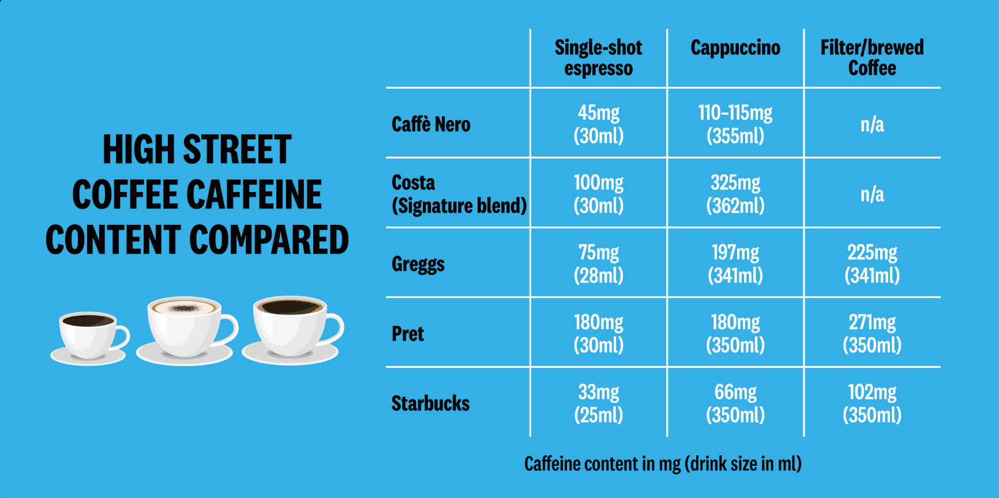
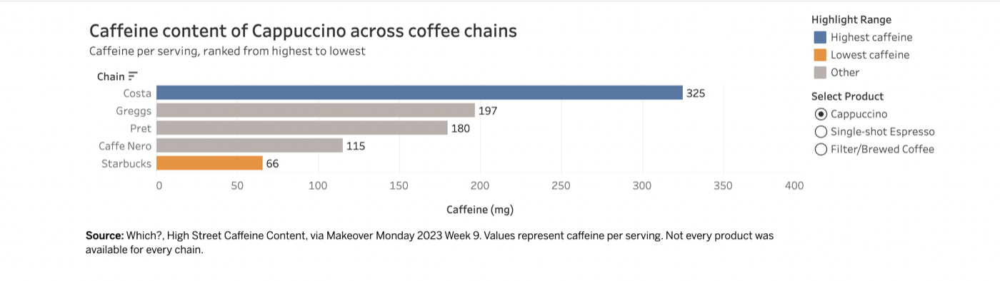
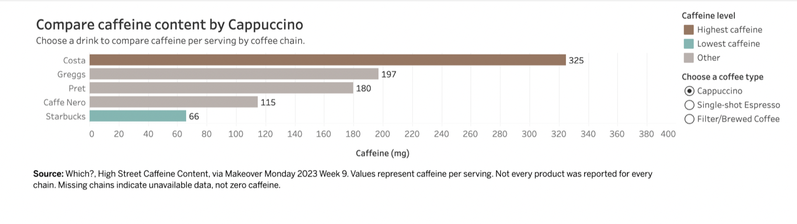

| [home page](./) | [data viz examples](dataviz-examples) | [critique by design](critique-by-design) | [final project I](final-project-part-one) | [final project II](final-project-part-two) | [final project III](final-project-part-three) |

[&larr; Back to main portfolio](./#portfolio)

# High Street Coffee Caffeine Redesign

_Makeover Monday 2023 Week 9 · Critique by Design_

External links on this page open in a new tab.

## Original Visualization

Original visualization: Which?, via Makeover Monday 2023 Week 9. <a href="https://makeovermonday.vercel.app/dataset/2023w9" target="_blank" rel="noopener noreferrer">View the original visualization and dataset</a>.

## Why I Selected This Visualization

I selected this visualization because coffee is a familiar product, yet caffeine levels can vary substantially between chains even when the drinks share the same name. The original provides useful caffeine and serving-size data, but its table format requires readers to scan individual cells and mentally compare the values. This created an opportunity to redesign the information around faster comparison and a clearer visual hierarchy.

## Critique of the Original Visualization

The original visualization is useful and largely complete because it presents caffeine content and serving size for three common products across five recognizable coffee chains. Its labeled matrix makes exact values easy to locate and reveals meaningful differences, such as Costa's 325 mg cappuccino compared with Starbucks' 66 mg version. The consistent units and organization support accuracy and make the topic understandable to general coffee consumers.

However, it functions more effectively as a reference table than as a comparison visualization. Readers must scan individual cells and mentally compare numbers because magnitude is not encoded through position or length. The chains are not ranked, extreme values are not highlighted, and the title does not communicate a key takeaway. The decorative cups and oversized title establish the subject but consume space without improving understanding. The bright background and condensed typeface also reduce readability. Serving sizes vary slightly, but the visualization does not explain how this affects comparison.

The primary audience is everyday coffee consumers, especially people comparing drinks or monitoring their caffeine consumption. I consider the original moderately effective: it provides relevant values, but it does not support quick, decision-oriented comparison.

## Critique Method Reflection

Stephen Few's Data Visualization Effectiveness Profile helped me evaluate the visualization across separate dimensions, including usefulness, completeness, perceptibility, truthfulness, intuitiveness, aesthetics, and engagement. This prevented the critique from being based only on appearance. For example, the original visualization performs relatively well in completeness and truthfulness because it includes labeled caffeine and serving-size values, but it performs less effectively in perceptibility because readers must manually compare the values.

Compared with the Good Charts method, Stephen Few's profile is more structured and diagnostic, while Good Charts places more emphasis on balancing useful information with visual engagement. The numerical scale helped organize my observations, but adjacent ratings can still be subjective. The written justification was therefore more valuable than the exact numerical score. Accessibility, mobile responsiveness, source transparency, and the quality of interaction could also be addressed more explicitly by the evaluation method.

## Sketch and Initial Design

My initial design replaced the static matrix with an interactive horizontal bar chart. Users could select a coffee type, compare chains using bar length, and see the chains ranked from highest to lowest caffeine content. The highest value was highlighted, while serving-size information remained available through tooltips.

<a href="https://public.tableau.com/app/profile/surabhi.byju/viz/CaffeinebyChain/Dashboard1" target="_blank" rel="noopener noreferrer">Open the initial Tableau prototype</a>

## User Testing

I tested the prototype with two participants:

- Participant 1: Graduate student and regular coffee consumer
- Participant 2: Graduate student familiar with data visualization

Findings:

- Both participants found the coffee-type selector useful.
- The brown color palette was considered appropriate for the subject.
- One participant wanted the highest-caffeine chain to receive stronger emphasis.
- One participant wanted the lowest-caffeine chain highlighted as well.
- The original prototype title made the visualization appear limited to cappuccino.
- The phrase "ranked from highest to lowest" was considered redundant because the ordering was already visible.
- The participants recommended clearer title and subtitle wording.

## Changes Made After Feedback

| Feedback | Change made |
|---|---|
| The product selector was useful | Retained the interactive selector |
| Brown suited the coffee subject | Retained brown for the highest-caffeine value |
| The highest value needed stronger emphasis | Kept a distinct dark-brown highlight and visible value label |
| The lowest value should also stand out | Added teal highlighting for the lowest-caffeine value |
| The title appeared limited to cappuccino | Added a dynamic title that updates with the selected product |
| "Ranked highest to lowest" was redundant | Removed the phrase from the subtitle |
| The interaction needed clearer instructions | Renamed the control "Choose a coffee type" and added a short instruction |

## Final Redesign

  <noscript>
    
  </noscript>
  <object class='tableauViz' style='display:none;'>
    <param name='host_url' value='https%3A%2F%2Fpublic.tableau.com%2F' />
    <param name='embed_code_version' value='3' />
    <param name='site_root' value='' />
    <param name='name' value='CaffeinebyChain&#47;FinalRedesign' />
    <param name='tabs' value='no' />
    <param name='toolbar' value='yes' />
    <param name='static_image' value='https://public.tableau.com/static/images/Ca/CaffeinebyChain/FinalRedesign/1.png' />
    <param name='animate_transition' value='yes' />
    <param name='display_static_image' value='yes' />
    <param name='display_spinner' value='yes' />
    <param name='display_overlay' value='yes' />
    <param name='display_count' value='yes' />
    <param name='language' value='en-US' />
  </object>

  <a href="https://public.tableau.com/app/profile/surabhi.byju/viz/CaffeinebyChain/FinalRedesign" target="_blank" rel="noopener noreferrer" style="display: inline-block; padding: 0.6em 1.2em; background: #4a2c17; color: #ffffff; border-radius: 4px; text-decoration: none;">Open the final dashboard on Tableau Public</a>

The final visualization allows users to select cappuccino, single-shot espresso, or filter/brewed coffee and compare caffeine content by chain. The bars are sorted from highest to lowest, the highest value is shown in brown, and the lowest value is shown in teal. A fixed 0–400 mg scale supports consistent comparisons across selections. Exact caffeine values appear on the chart, while serving sizes are available through tooltips. The dashboard also explains that missing chains represent unavailable data rather than zero caffeine.

## Reflection

The redesign changes the original from a reference table into a comparison and exploration tool. Bar length reduces the effort required to compare values, sorting establishes an immediate ranking, and selective color creates a clear visual hierarchy. User feedback improved the final design by making both extremes visible and clarifying that multiple coffee types can be explored. The final result preserves the original data while making its key differences faster to recognize.

## Sources

- <a href="https://makeovermonday.vercel.app/dataset/2023w9" target="_blank" rel="noopener noreferrer">Makeover Monday 2023 Week 9 dataset and original visualization</a>
- Which?, High Street Coffee Caffeine Content (via Makeover Monday 2023 Week 9)
- <a href="https://public.tableau.com/app/profile/surabhi.byju/viz/CaffeinebyChain/FinalRedesign" target="_blank" rel="noopener noreferrer">Tableau Public final dashboard: Caffeine by Chain, Final Redesign</a>
- Stephen Few, Data Visualization Effectiveness Profile
- Scott Berinato, Good Charts, Chapters 3 and 4

## AI Use Disclosure

I used ChatGPT to help interpret the assignment requirements, organize my critique, refine user-testing questions, troubleshoot Tableau implementation, and improve the clarity of my written explanations. I independently selected the visualization, evaluated the original design, conducted user testing, made the final design decisions, and verified the finished Tableau dashboard.

[&larr; Back to main portfolio](./#portfolio)

